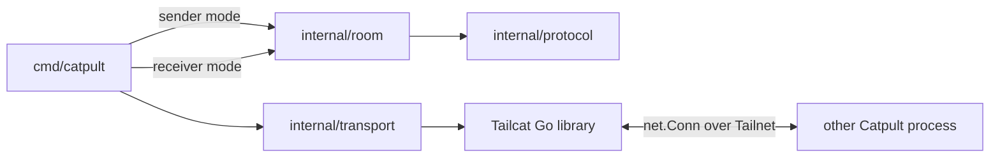

# System overview

Catpult is a single foreground process. In sender mode it hosts a temporary room; each recipient connects directly to that room using the Tailcat invite. There is no Catpult backend or persistent room state. Tailcat supplies the encrypted network and may relay traffic through DERP.

## Responsibilities

- `cmd/catpult`: parses one command shape into file sender, watch sender, stream sender, or receiver; owns expiry, signals, logging, and process I/O.
- `internal/transport`: adapts Tailcat to one TCP service port (`8411`), returns the invite, dials the invite, and configures the relay bootstrap.
- `internal/protocol`: Catpult framing, mode announcement, file headers, and message/resource limits. It is transport-independent.
- `internal/room`: one connection's file/watch/stream serving and receiving, stream fan-out/cache, watch polling, and receive-path safety.

The sender opens one Catpult application connection per recipient. Tailcat authenticates the peer to the invite's Tailnet; the Catpult protocol itself does not add identities, acknowledgments, or a second cryptographic layer. Delivery is best effort.

## Lifetimes

The sender's default room lifetime is 30 minutes; `--expires` changes it and `--no-expiry` disables it. Sender shutdown stops room work, closes active connections, drains Tailcat TCP where possible, then closes the Tailcat server. The receiver exits after a finite file transfer, stream end/connection close, room closure, or local interrupt. Watch receivers remain connected until room closure or disconnect.

## Source map

| Concern | Implementation |
| --- | --- |
| Argument dispatch and lifecycle | [`cmd/catpult/main.go`](../../cmd/catpult/main.go) |
| Tailcat adapter | [`internal/transport/transport.go`](../../internal/transport/transport.go) |
| Framing and message definitions | [`internal/protocol/protocol.go`](../../internal/protocol/protocol.go) |
| File sender | [`internal/room/sender_file.go`](../../internal/room/sender_file.go) |
| Stream sender | [`internal/room/sender_stream.go`](../../internal/room/sender_stream.go) |
| Watch sender | [`internal/room/watch.go`](../../internal/room/watch.go) |
| Receiver | [`internal/room/receiver.go`](../../internal/room/receiver.go) |
| Receive path validation | [`internal/room/safety_utils.go`](../../internal/room/safety_utils.go) |
